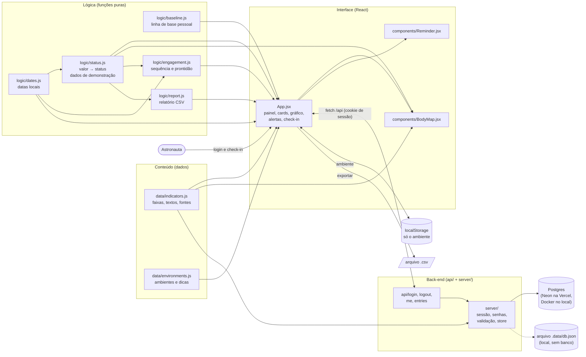
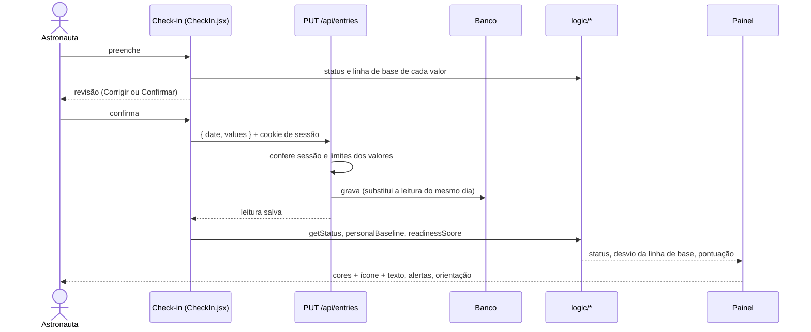
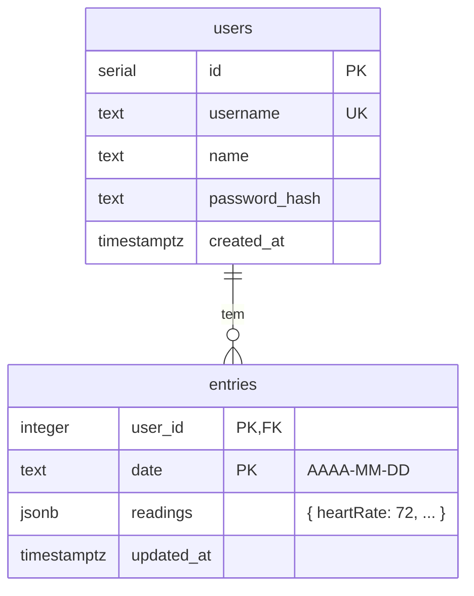

# Arquitetura

O app tem duas partes no mesmo repositório e no mesmo deploy:

- **Front-end:** página única em React (Vite), em `src/`.
- **Back-end:** funções em `api/` que a Vercel publica como serverless. Elas cuidam do login e guardam as leituras de cada astronauta num Postgres. Em desenvolvimento, o próprio Vite serve essas funções, então `npm run dev` sobe tudo junto.

## Visão geral



## Camadas

| Camada | Arquivos | Responsabilidade | Regra |
|---|---|---|---|
| Conteúdo | `src/data/` | Faixas de referência, textos de orientação, fontes, ambientes | Só dados. Corrigir uma faixa ou texto nunca exige mexer na lógica |
| Lógica | `src/logic/` | Calcular status, linha de base, pontuação, relatório e datas | Funções puras, sem React, fáceis de testar |
| Interface | `src/Root.jsx`, `src/App.jsx`, `src/components/`, `src/api.js` | Login, painel e check-in | Não decide regras médicas, só chama a lógica |
| API | `api/` | Uma função por rota (`/api/<nome>` → `api/<nome>.js`) | Só recebe, valida e responde; a regra fica em `server/` |
| Servidor | `server/` | Sessão, senhas, validação e acesso ao banco | O mesmo código roda na Vercel e no `npm run dev` |

A decisão mais importante é **separar conteúdo e lógica**. Todo o conteúdo médico fica em `indicators.js`, e cada indicador diz o que vem de fonte e o que é decisão do app.

## Fluxo de uma leitura



1. O valor é comparado com as faixas do indicador: dentro da faixa normal é **normal**; fora dela, mas dentro dos limites críticos, é **atenção**; além dos limites críticos é **contatar o cirurgião de voo**.
2. O valor também é comparado com a **linha de base pessoal** (veja [indicadores-e-fontes.md](indicadores-e-fontes.md#linha-de-base-pessoal)).
3. Cada parte do corpo mostra o **pior status** entre os indicadores ligados a ela.
4. O status geral no topo é o pior status entre todos os indicadores.

## Back-end

### Rotas

| Rota | Método | Login | O que faz |
|---|---|---|---|
| `/api/login` | POST `{ username, password }` | Não | Confere a senha e grava o cookie de sessão |
| `/api/logout` | POST | Não | Apaga o cookie |
| `/api/me` | GET | — | Devolve o usuário logado, ou 401 com a dica da conta demo |
| `/api/entries` | GET | Sim | Lista as leituras do astronauta, da mais antiga para a mais nova |
| `/api/entries` | PUT `{ date, values }` | Sim | Salva a leitura do dia (substitui a do mesmo dia) |

### Login e segurança

- **Sem cadastro:** as contas são criadas pela equipe com `npm run create-user` (veja [como-executar.md](como-executar.md#contas-da-tripulação)).
- **Senhas** guardadas com `scrypt` (nativo do Node), com sal aleatório.
- **Sessão** em cookie `HttpOnly`, `SameSite=Lax` e `Secure` em HTTPS, assinado com HMAC usando `SESSION_SECRET`. Vale por 7 dias. O JavaScript da página não tem acesso ao token.
- **Validação no servidor:** só aceita indicadores conhecidos e valores dentro dos limites de entrada de `indicators.js`.
- **Isolamento:** cada astronauta só lê e grava as próprias leituras.

### Banco de dados

| Situação | Onde grava |
|---|---|
| `DATABASE_URL` definida | Postgres. As tabelas são criadas sozinhas na primeira requisição |
| Sem `DATABASE_URL`, no seu computador | Arquivo `.data/db.json` (fora do Git). Zero configuração |
| Sem `DATABASE_URL`, na Vercel | Erro claro pedindo para conectar um banco |



**Conta demo:** com o banco vazio, o servidor cria `astronaut` / `mars2026` com 14 dias de dados de demonstração, e a tela de login mostra essas credenciais para os avaliadores. As datas são as do dia em que a conta foi criada. Para desligar, use `DEMO_ACCOUNT=off`.

### Variáveis de ambiente

| Variável | Onde | Para que |
|---|---|---|
| `DATABASE_URL` | Vercel (obrigatória) e local (opcional) | Conexão com o Postgres |
| `SESSION_SECRET` | Vercel (obrigatória) | Assinar os cookies de sessão. Em desenvolvimento há um valor padrão |
| `DEMO_ACCOUNT` | Opcional | `off` desliga a conta demo |

O modelo está em `.env.example`. Localmente, copie para `.env.local`, que fica fora do Git.

### O que fica no navegador

Só o ambiente da missão escolhido (`localStorage`, chave `astro-health-environment`) e a data da última notificação de lembrete (`astro-health-last-notified`). As leituras ficam no servidor, então aparecem em qualquer aparelho em que o astronauta entrar.

## Estrutura de arquivos

```text
├── index.html
├── package.json
├── vite.config.js
├── docker-compose.yml          Postgres para desenvolvimento local
├── .env.example                modelo das variáveis de ambiente
├── README.md                   apresentação pública (inglês)
├── docs/                       documentação interna (português)
├── api/                        rotas do back-end (uma função por arquivo)
│   ├── login.js
│   ├── logout.js
│   ├── me.js
│   └── entries.js
├── server/                     código compartilhado do back-end
│   ├── http.js                 respostas JSON, leitura do corpo, erros
│   ├── session.js              cookie de sessão assinado
│   ├── passwords.js            hash de senha com scrypt
│   ├── store.js                Postgres ou arquivo local, conta demo
│   └── validate.js             validação das leituras
├── scripts/
│   └── create-user.js          cria ou atualiza contas da tripulação
└── src/
    ├── main.jsx                ponto de entrada
    ├── Root.jsx                decide entre login e painel, carrega as leituras
    ├── api.js                  cliente das rotas /api
    ├── App.jsx                 painel, cards, gráfico, alertas, exportação
    ├── styles.css              visual e layout
    ├── components/
    │   ├── BodyMap.jsx         figura do corpo clicável
    │   ├── CheckIn.jsx         formulário e revisão antes de salvar
    │   ├── Login.jsx           tela de login (sem cadastro)
    │   ├── Reminder.jsx        aviso e notificação de check-in
    │   └── StatusBadge.jsx     selo de status (cor + ícone + texto)
    ├── data/
    │   ├── indicators.js       faixas, textos e fontes
    │   └── environments.js     ambientes da missão e dicas
    └── logic/
        ├── status.js           regras de status e dados de demonstração
        ├── baseline.js         linha de base pessoal
        ├── engagement.js       sequência de dias e pontuação de prontidão
        ├── report.js           relatório CSV
        └── dates.js            datas no fuso local
```

## Tecnologias

| Tecnologia | Uso | Por que |
|---|---|---|
| React 18 | Interface em componentes | Separa painel, corpo clicável e formulário |
| Vite 5 | Servidor de desenvolvimento e build | Inicia rápido e a Vercel reconhece sem configuração |
| Recharts | Gráficos de tendência | Integra com React e permite sombrear a faixa normal |
| SVG | Figura do corpo | Partes clicáveis, coloridas e acessíveis pelo teclado |
| Funções serverless da Vercel | Back-end | Mesmo deploy e mesma URL do front, sem servidor para manter |
| Postgres (`pg`) | Banco de dados | Gratuito no Neon pela Vercel; Docker no desenvolvimento |
| `node:crypto` | Senhas e sessão | Nativo do Node, sem dependências extras de segurança |
| Docker Compose | Postgres local | Um comando para ter o mesmo banco da produção |
