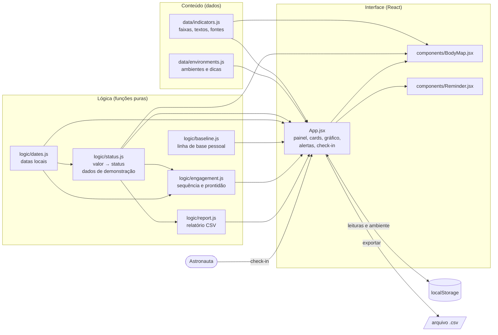
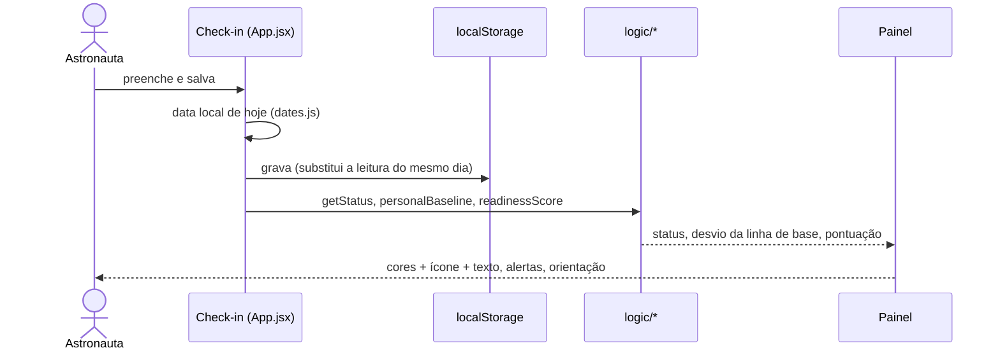

# Arquitetura

O app é uma página única em React, sem servidor: tudo roda no navegador e as leituras ficam no `localStorage`.

## Visão geral



## Camadas

| Camada | Arquivos | Responsabilidade | Regra |
|---|---|---|---|
| Conteúdo | `src/data/` | Faixas de referência, textos de orientação, fontes, ambientes | Só dados. Corrigir uma faixa ou texto nunca exige mexer na lógica |
| Lógica | `src/logic/` | Calcular status, linha de base, pontuação, relatório e datas | Funções puras, sem React, fáceis de testar |
| Interface | `src/App.jsx`, `src/components/` | Mostrar o painel e receber as leituras | Não decide regras médicas, só chama a lógica |

A decisão mais importante é **separar conteúdo e lógica**. Todo o conteúdo médico fica em `indicators.js`, e cada indicador diz o que vem de fonte e o que é decisão do app.

## Fluxo de uma leitura



1. O valor é comparado com as faixas do indicador: dentro da faixa normal é **normal**; fora dela, mas dentro dos limites críticos, é **atenção**; além dos limites críticos é **contatar o cirurgião de voo**.
2. O valor também é comparado com a **linha de base pessoal** (veja [indicadores-e-fontes.md](indicadores-e-fontes.md#linha-de-base-pessoal)).
3. Cada parte do corpo mostra o **pior status** entre os indicadores ligados a ela.
4. O status geral no topo é o pior status entre todos os indicadores.

## Armazenamento local

| Chave do `localStorage` | Conteúdo |
|---|---|
| `astro-health-entries` | Lista de leituras: `{ date: "AAAA-MM-DD", values: { heartRate: 72, ... } }`, uma por dia |
| `astro-health-environment` | Ambiente selecionado (`station`, `spacecraft`, `rover`, `moon`, `mars`) |
| `astro-health-last-notified` | Último dia em que a notificação de lembrete foi enviada |

Se não houver leituras salvas, o app gera 14 dias de dados de demonstração (determinísticos, sempre iguais). Para voltar a eles, rode `localStorage.clear()` no console do navegador.

**Limitação:** os dados ficam em cada navegador. O celular não vê o que foi salvo no computador.

## Estrutura de arquivos

```text
├── index.html
├── package.json
├── vite.config.js
├── README.md                   apresentação pública (inglês)
├── docs/                       documentação interna (português)
└── src/
    ├── main.jsx                ponto de entrada
    ├── App.jsx                 painel, cards, gráfico, alertas, check-in, exportação
    ├── styles.css              visual e layout
    ├── components/
    │   ├── BodyMap.jsx         figura do corpo clicável
    │   └── Reminder.jsx        aviso e notificação de check-in
    ├── data/
    │   ├── indicators.js       faixas, textos e fontes
    │   └── environments.js     ambientes da missão e dicas
    └── logic/
        ├── status.js           regras de status e dados de demonstração
        ├── baseline.js         linha de base pessoal
        ├── engagement.js       sequência de dias e pontuação de prontidão
        ├── report.js           relatório CSV
        └── dates.js            datas no fuso local
```

## Tecnologias

| Tecnologia | Uso | Por que |
|---|---|---|
| React 18 | Interface em componentes | Separa painel, corpo clicável e formulário |
| Vite 5 | Servidor de desenvolvimento e build | Inicia rápido e a Vercel reconhece sem configuração |
| Recharts | Gráficos de tendência | Integra com React e permite sombrear a faixa normal |
| SVG | Figura do corpo | Partes clicáveis, coloridas e acessíveis pelo teclado |
| localStorage | Armazenamento | Dispensa servidor e banco de dados |
